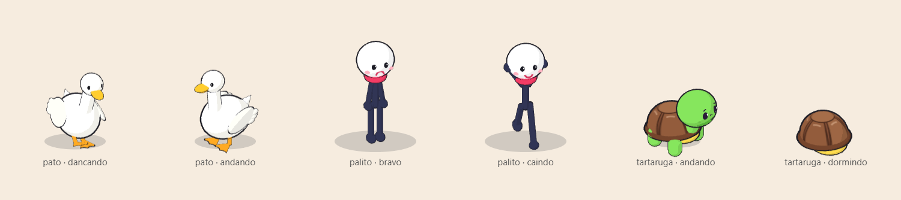

# Mascote Desktop

Um bichinho que mora na **sua tela** e conversa com você usando o **Claude Code** por trás.
Vêm três pets em **3D de verdade**: o **Palito** (padrão), o **Pato** e a **Tartaruga** (troque em
Configurações → Pet). Eles giram para a direção em que andam, e cada um conversa com uma personalidade própria.


- **Chat com o Claude Code:** clique no botão laranja para conversar. Ele lê arquivos e ajuda com
  código na pasta que você escolher, sempre pedindo permissão antes de mexer em algo. Dá para
  **colar imagens** (Ctrl+V, ou Cmd+V no Mac) para ele ver.
- **Um bichinho de verdade:** ele pisca, acena, cochila e passeia (se você deixar). Clique para dar
  carinho, use o **botão direito** para dar comida ou jogar bola, **chacoalhe** e ele fica tonto (e
  depois bravo com você), e **solte ele lá do alto** para ver o paraquedas.
- **3D de verdade:** modelos feitos com three.js, vistos de cima na diagonal. O Pato (branco, de pescoço
  comprido) anda gingando, dança de vez em quando e plana com as asas abertas em vez de usar paraquedas;
  a Tartaruga se esconde no casco dormindo, caindo ou sendo chacoalhada; o Palito usa cachecol. Se a placa
  de vídeo não tiver WebGL, ele usa sozinho um desenho com volume parecido.
- **Chão:** ele anda pela tela inteira ou só em cima da barra de tarefas, em todos os monitores ou
  em um só.
- **Modo bagunça (opcional):** ele rouba o seu mouse (no estilo do Desktop Goose), traz bilhetinhos
  coloridos e faz travessuras como apertar Alt+Tab ou abrir o navegador. Cada travessura liga e desliga
  nas configurações, e dá para criar as suas.
- **Feito para a comunidade:** bilhetes, travessuras e pets próprios são só arquivos JSON (veja
  [abaixo](#bilhetes-da-comunidade) e [CRIAR_PET.md](CRIAR_PET.md)).
- **Aplicativo de verdade no Windows, macOS e Linux:** instalador (`.exe`, `.dmg`, AppImage e `.deb`),
  ícone na bandeja (ou na barra de menus do Mac) e iniciar junto com o computador.

Mecânicas inspiradas nos pets de desktop clássicos, com personagens e código originais.

## Requisitos

- Node.js 18 ou superior
- Claude Code instalado e logado, para o chat funcionar:
  ```bash
  npm install -g @anthropic-ai/claude-code
  claude   # faça o login uma vez e saia
  ```
  Alternativa: defina a variável `ANTHROPIC_API_KEY`.
- **Ou outra IA:** o chat também funciona com o Gemini, a OpenAI, o OpenRouter, o Ollama (offline)
  ou qualquer API no formato da OpenAI. Veja [Usar outra IA](#usar-outra-ia).

## Rodar

```bash
npm install
npm start
```

### Instalar como aplicativo (Windows, macOS e Linux)

Os instaladores são gerados automaticamente pelo GitHub Actions (aba **Actions** → "Gerar
instaladores" → baixe o do seu sistema; nas versões com tag eles também ficam em **Releases**).
Para gerar no seu próprio computador:

```bash
npm install
npm run dist        # gera para o sistema em que você está, na pasta dist/
```

| Sistema | Arquivo | Como instalar |
|---|---|---|
| Windows | `Mascote Desktop Setup x.y.z.exe` | Abra e siga o instalador |
| macOS (Apple Silicon) | `Mascote Desktop-x.y.z-arm64.dmg` | Abra e arraste para Aplicativos |
| macOS (Intel) | `Mascote Desktop-x.y.z.dmg` | Abra e arraste para Aplicativos |
| Linux (qualquer distro) | `Mascote Desktop-x.y.z.AppImage` | `chmod +x` no arquivo e abra |
| Ubuntu, Debian, Mint | `mascote-desktop_x.y.z_amd64.deb` | `sudo apt install ./mascote-desktop_x.y.z_amd64.deb` |

**Mac, primeira vez:** o app não é assinado por um desenvolvedor Apple (custa US$ 99/ano), então o
macOS avisa que não pode verificar o app. Clique com o botão direito no Mascote Desktop em Aplicativos
→ **Abrir** → **Abrir**. Se aparecer "está danificado", rode uma vez no Terminal:
`xattr -cr "/Applications/Mascote Desktop.app"`.

O instalador já traz o Claude Code dentro dele (por isso é grande, ~250 MB). Você só precisa fazer o
login uma vez (`claude` no terminal) ou definir `ANTHROPIC_API_KEY`.

### Abrir pelo código como um aplicativo (Windows e Linux)

Para não precisar do terminal toda vez, crie os atalhos uma vez:

```bash
npm run atalho
```

No Windows, isso coloca **Mascote Desktop**, com ícone próprio, no Menu Iniciar e na Área de Trabalho.
No Linux, coloca no menu de aplicativos. É só clicar para abrir, como qualquer programa, sem janela de
terminal. (No Mac, use `npm run dist`, acima.) Para tirar os atalhos:
`npm run atalho -- --remover`. Para ele abrir sozinho junto com o computador, use Configurações → Iniciar com o Windows (no Mac, "Abrir
ao entrar no Mac"; no Linux, "Iniciar com o Linux").

## Como usar

| Ação | Como |
|---|---|
| Conversar | Clique no botão laranja no canto inferior direito |
| Mudar o chat de lugar | Arraste o botão do chat ou o de brinquedos, que andam juntos (ou o topo do painel aberto). Configurações → Chat no canto desfaz |
| Escolher em que tela o pet fica | Configurações → Telas (todas, ou uma específica) |
| Escolher em que pasta ele trabalha | Clique na linha da pasta no topo do chat |
| Carinho | Clique no pet |
| Dar comida / brincar de bola | Botão pequeno de brinquedos, ao lado do chat (ou botão direito no pet) |
| Chutar a bola | Clique nela: ela vai para o lado oposto de onde você clicou. O pet chuta de volta na direção do seu mouse |
| Andar só em cima da barra de tarefas | Configurações → Chão |
| Mudar o pet de lugar | Arraste o pet com o mouse |
| Ligar passeio / modo bagunça | Configurações do chat, ou o ícone na bandeja do sistema |
| Trocar de pet / abrir a pasta de pets | Configurações do chat |
| Escolher os bilhetes que ele traz | Configurações → Pasta de bilhetes |
| Ligar travessuras (pegar o mouse, Alt+Tab, navegador) / criar novas | Configurações → Travessuras / Pasta de travessuras |
| Fazer o pet voltar para o canto | Configurações → Chamar de volta |
| Minimizar | Botão **–** no topo do chat: pet, chat e bilhetes somem e fica só o ícone na bandeja (perto do relógio). Clique nele para trazer de volta |
| Fechar | Botão **X** no topo do chat, Configurações → Fechar o app, a bandeja, ou **Ctrl+Alt+Shift+Q** (no Mac, **Cmd+Option+Shift+Q**) |
| Abrir de novo | Atalho **Mascote Desktop** (se já estiver aberto, ele volta da bandeja e abre o chat) |

Quando o pet rouba o seu mouse no modo bagunça, não adianta puxar: ele segura até cansar (alguns segundos).

### Imagens no chat

Cole uma imagem com **Ctrl+V** no campo de mensagem (ou arraste o arquivo para o chat). Vão até 4 por
mensagem (PNG, JPG, GIF ou WEBP, até 5 MB cada), e o Claude Code vê a imagem junto com o seu texto.

### Brincar com o pet



- **Chão** (Configurações → Chão): ele pode andar pela **tela inteira** ou **só em cima da barra de tarefas**, como
  se ela fosse o chão.
- **Derrubar:** no modo barra de tarefas, arraste o pet lá para cima e solte. Ele cai e abre um
  paraquedas.
- **Chacoalhar:** segure o pet e sacuda o mouse de um lado para o outro. Ele fica tonto (estrelinhas e
  olhos em espiral) e depois fica bravo com você. Bravo, ele recusa carinho e brincadeira por um tempo.
  Uma comidinha resolve.
- **Brinquedos** (botão pequeno ao lado do chat, ou botão direito no pet): **Comida** (ele vai até a
  comida e come) e **Bola de futebol**. Clique na bola para chutar: ela vai para o lado oposto de onde
  você clicou, e o pet corre atrás e chuta de volta na direção do seu mouse. Se você parar de jogar,
  depois de uns 15 s ele cansa. A bola segue o **Chão** escolhido: no modo barra de tarefas ela
  tem gravidade e quica em cima da barra; no modo tela inteira ela rola pela tela toda, vista de cima,
  como o pet anda. Pelo botão direito também tem **Carinho**. Se ficar muito tempo sem
  comer, ele avisa que está com fome.

## Bilhetes da comunidade

No modo bagunça o pet traz bilhetes. Ele já vem com 40 mensagens, e você pode colocar as suas:
abra **Configurações → Pasta de bilhetes** e edite o `bilhetes.json`:

```json
{
  "substituir": false,
  "bilhetes": [
    "Só um texto",
    { "texto": "Com cor própria", "cor": "#e8dcff" },
    { "imagem": "gatinho.png" },
    { "imagem": "meme.gif", "texto": "legenda se a imagem falhar", "cor": "#d4f1ff" }
  ]
}
```

- As imagens ficam na mesma pasta (png, jpg, gif ou webp, até 5 MB).
- `cor` é opcional (`#rrggbb`); sem ela, ele sorteia uma cor de post-it.
- `"substituir": true` usa **só** os seus bilhetes; com `false`, eles se juntam aos padrão.
- Vale na hora, sem reiniciar. Pets também podem ter bilhetes próprios no `pet.json`.

## Travessuras

Com o modo bagunça ligado, ative em **Configurações → Travessuras** as que quiser. "Pegar o mouse" vem ligada;
as outras começam desligadas.
Ele faz no máximo uma a cada 3 minutos (e nenhuma nos 3 primeiros minutos depois de abrir o app). Para criar as suas, abra **Configurações → Pasta de travessuras**
e edite o `travessuras.json`:

```json
{
  "travessuras": [
    { "id": "minimiza-tudo", "nome": "Minimizar tudo", "tipo": "teclas", "teclas": ["win", "d"], "vezes": 1 },
    { "id": "alt-tab-doido", "nome": "Alt+Tab doido", "tipo": "teclas", "teclas": ["alt", "tab"], "vezes": [3, 8] },
    { "id": "patos", "nome": "Fotos de patos", "tipo": "abrir", "links": ["https://www.google.com/search?q=patos+fofos"] }
  ]
}
```

- **teclas:** as primeiras ficam seguradas e a última é apertada `vezes` vezes (número ou
  `[mín, máx]`, até 10). Só são aceitas teclas que não apagam, enviam ou fecham nada:
  `alt, tab, shift, win, esquerda, cima, direita, baixo, d, m`. Funciona no Windows, no macOS e no
  Linux com X11. No Mac, `alt` vira Command (Alt+Tab vira Cmd+Tab) e `win` vira Control, que só vale
  com setas (Ctrl+setas troca de Space); combinações perigosas no Mac, como Cmd+D, são puladas.
- **abrir:** sorteia um dos links (só `http://` ou `https://`).
- **"admin": true:** a travessura aparece com cadeado e só pode ser ligada com o app rodando como
  administrador.

Além dessas, há duas que o próprio pet faz: **Seguir o mouse** (vai atrás do cursor sem pegar) e
**Pegar o mouse**: ele morde o cursor e sai correndo de costas, puxando. Não adianta puxar de volta:
ele só solta quando cansa.

### Permissão de administrador (opcional)

Nada no mascote precisa de administrador. A diferença é que, sem a permissão, o Windows não deixa um
programa comum apertar teclas quando a janela da frente é de administrador (Gerenciador de Tarefas,
terminal admin...). Nesses casos ele pula a travessura. Para liberar, use **Configurações → Pedir permissão ao
Windows**: o app reabre e o Windows pergunta se você permite. Depois disso, a opção "Também em janelas
de administrador" pode ser ligada.

Cuidado: como administrador, o chat (Claude Code) também roda com essa permissão. Os pedidos de
Permitir/Negar continuam aparecendo, então leia bem cada um.

**Configurações → Iniciar com o Windows** faz o mascote abrir sozinho quando você liga o PC (não precisa de admin).

## macOS e Linux

Tudo funciona nos três sistemas, com estas diferenças (que vêm dos próprios sistemas):

| Função | Windows | macOS | Linux (X11/Xorg) | Linux (Wayland) |
|---|---|---|---|---|
| Pet, chat, bilhetes, brincadeiras | Sim | Sim | Sim | Sim |
| Ícone perto do relógio | Bandeja | Barra de menus | Bandeja (no GNOME, precisa da extensão AppIndicator, que o Ubuntu já traz) | Igual ao X11 |
| Iniciar com o sistema | Sim | Sim (app instalado) | Sim | Sim |
| Pegar o mouse | Sim | Sim | Sim | Não |
| Travessuras de teclado | Sim | Sim, com Acessibilidade | Sim | Não |
| Abrir o navegador | Sim | Sim | Sim | Sim |
| Pet percebe o mouse em qualquer lugar | Sim | Sim | Sim | Só em cima das janelas do próprio app |
| Andar em cima da barra | Barra de tarefas | Em cima do Dock | Em cima do painel de baixo | Igual ao X11 |
| Permissão extra | Administrador (opcional) | Acessibilidade (só para teclas) | Nenhuma | — |

**Mac, permissão de Acessibilidade:** o macOS só deixa um app apertar teclas por você se ele estiver
em Ajustes do Sistema → Privacidade e Segurança → **Acessibilidade**. As travessuras de teclado
aparecem com cadeado até você ligar; o botão **Configurações → Abrir os Ajustes do Mac** leva direto para lá.
Pegar o mouse e todo o resto funcionam sem ela. O pet mora na barra de menus, sem ícone no Dock.

**Mac com dois monitores:** com "Monitores têm Spaces separados" ligado (o padrão do macOS), uma janela
não aparece em dois monitores ao mesmo tempo. Então o pet mora no monitor do chat; arraste o chat para
outro monitor e ele vai junto. Com a opção desligada (Ajustes → Mesa e Dock), ele anda por todos.

**Linux com Wayland** (padrão no Ubuntu e Fedora novos): o app abre sozinho pelo XWayland, porque o
Wayland não deixa um app escolher onde a própria janela fica. Mesmo assim, o Wayland não deixa nenhum
app comum apertar teclas, mover o mouse ou saber onde ele está fora das próprias janelas. Isso é uma
regra de segurança do Wayland, não dá para contornar de dentro do app. Para ter tudo, escolha a
sessão **"Ubuntu em Xorg"** (ou "GNOME em Xorg", "Plasma (X11)") na engrenagem da tela de login.
O aviso aparece nas configurações quando você está no Wayland.

**Linux, transparência:** precisa de um compositor (o padrão no GNOME, KDE, Cinnamon e XFCE novos).
Sem ele, o fundo do pet fica preto.

## Problemas?

O app grava um log em `%APPDATA%\mascote-desktop\logs\mascote.log` (Windows),
`~/Library/Application Support/mascote-desktop/logs` (macOS) ou `~/.config/mascote-desktop/logs` (Linux),
incluindo erros das páginas. Se o pet sumir da tela, ele volta sozinho para o canto em ~3 s.

Para depurar: `MASCOTE_DEBUG=perseguir npm start` (persegue o mouse sem parar) ou
`MASCOTE_DEBUG=travessura npm start` (faz as travessuras ligadas sem intervalo) ou
`MASCOTE_DEBUG=voltar npm start` (leva o pet para longe e chama de volta) ou
`MASCOTE_DEBUG=bilhete npm start` (no modo bagunça, ele vai buscar bilhetes toda hora) ou
`MASCOTE_DEBUG=dancar npm start` (o Pato dança sem parar).

## Usar outra IA

O Claude Code é o padrão, mas dá para trocar em Configurações → **IA do chat**:

| IA | O que precisa |
| --- | --- |
| Claude Code | Claude Code instalado e logado (ou `ANTHROPIC_API_KEY`) |
| Gemini (Google) | Chave grátis do [Google AI Studio](https://aistudio.google.com/apikey) |
| OpenAI (ChatGPT) | Chave da [API da OpenAI](https://platform.openai.com/api-keys) |
| OpenRouter | Chave do [OpenRouter](https://openrouter.ai/keys) (modelos de várias empresas) |
| Ollama | [Ollama](https://ollama.com) aberto e um modelo com ferramentas (ex.: `ollama pull qwen3`) |
| Outra | Endereço de qualquer API compatível com OpenAI (LM Studio, Groq, DeepSeek, Mistral...) |

- Cole a chave e clique em **Salvar**. O botão **Ver** lista os modelos que a sua chave pode usar.
- A chave fica criptografada no cofre do sistema (Windows: DPAPI, macOS: Keychain, Linux: GNOME
  Keyring ou KWallet) e nunca volta para a página do chat. Se o Linux não tiver cofre, o app não
  salva a chave: use a variável `GEMINI_API_KEY`, `OPENAI_API_KEY` ou `OPENROUTER_API_KEY`.
- Com essas IAs, o pet usa as próprias ferramentas: listar, ler e procurar arquivos na pasta de
  trabalho (livre), e escrever, editar, rodar comandos ou mexer fora da pasta (**sempre pede
  Permitir/Negar**).
- Trocar de IA ou de modelo começa uma conversa nova.

## Segurança

- As páginas rodam isoladas (`contextIsolation` + `sandbox`, sem Node) e só falam com o
  processo principal por uma lista fixa de canais, com os dados validados.
- Nenhuma janela navega para fora do app, abre pop-ups ou recebe permissões do navegador.

O pet usa o Claude Code (ou a IA escolhida), que pode ler arquivos e rodar comandos. **Toda ação que mexe
no computador aparece no chat com os botões Permitir e Negar.** Nada roda sem você
aprovar.

## Limitações conhecidas (protótipo)

- Com monitores de escalas (DPI) diferentes, o desenho pode ficar maior num deles.
- No Linux com Wayland, o pet não pega o mouse nem aperta teclas (veja [macOS e Linux](#macos-e-linux)).
- No Linux, a transparência precisa de um compositor (o padrão no GNOME e KDE).
- O app do Mac não tem assinatura de desenvolvedor Apple: na primeira vez, abra com botão direito → Abrir.

## Créditos

- Ícones do chat: [Lucide](https://lucide.dev) (licença ISC, em `src/icones/LICENSE-lucide.txt`).
- Pets, ícone do app e desenhos: originais deste projeto (`src/pet3d.js`, com reserva em `src/vetor.js`).
- 3D: [three.js](https://threejs.org) (licença MIT).

## Observações

- Usa o Claude Code da sua própria conta, instalado no seu computador.
- Projeto não oficial, sem vínculo com a Anthropic. Não usa logo nem identidade
  visual do Claude/Anthropic.
- Se for distribuir para outras pessoas, leia os termos atuais sobre uso do Agent SDK:
  https://code.claude.com/docs/en/legal-and-compliance
