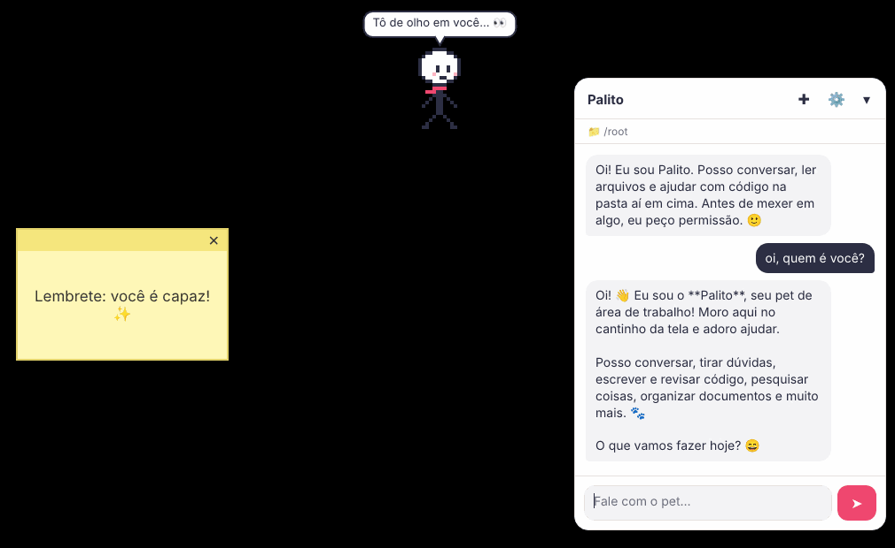

# 🐾 Mascote Desktop

Um bonequinho que mora no **cantinho da sua tela** e conversa com você usando o
**Claude Code** por trás. O pet padrão é o **Palito**, um stickman de cachecol, e
também vêm junto o **Pato** 🦆 e a **Tartaruga** 🐢 (troque em ⚙️ → Pet).

- 💬 **Chat fixo no canto:** clique no botão redondo para conversar. Ele fica sempre
  no mesmo lugar, então você não precisa caçar o pet pela tela.
- 🧍 **Quietinho por padrão:** ele fica perto do chat, pisca, acena e cochila.
- 🚶 **Passear (opcional):** deixe-o andar pela tela toda.
- 😈 **Modo bagunça (opcional):** ele corre atrás do seu mouse, pega e arrasta o
  cursor por aí, e traz bilhetinhos para a tela.
- 🎨 **Pets personalizados:** qualquer pessoa pode criar o próprio pet com uma pasta
  e um `pet.json` (veja [CRIAR_PET.md](CRIAR_PET.md)).



Mecânicas inspiradas nos pets de desktop clássicos, com personagem e código originais.

## Requisitos

- Node.js 18 ou superior
- Claude Code instalado e logado, para o chat funcionar:
  ```bash
  npm install -g @anthropic-ai/claude-code
  claude   # faça o login uma vez e saia
  ```
  Alternativa: defina a variável `ANTHROPIC_API_KEY`.

## Rodar

```bash
npm install
npm start
```

## Como usar

| Ação | Como |
|---|---|
| Conversar | Clique no botão 💬 no canto inferior direito |
| Escolher em que pasta ele trabalha | Clique na linha 📁 no topo do chat |
| Carinho | Clique no pet |
| Mudar o pet de lugar | Arraste o pet com o mouse |
| Ligar passeio / modo bagunça | ⚙️ no chat, ou o ícone na bandeja do sistema |
| Trocar de pet / abrir a pasta de pets | ⚙️ no chat |
| Fazer o pet voltar para o canto | ⚙️ → Chamar de volta |
| Fechar | ⚙️ → Fechar o app, a bandeja, ou **Ctrl+Alt+Shift+Q** |

Quando o pet segura o seu mouse no modo bagunça, clique nele para ele soltar.

## Segurança

- As páginas rodam isoladas (`contextIsolation` + `sandbox`, sem Node) e só falam com o
  processo principal por uma lista fixa de canais, com os dados validados.
- Nenhuma janela navega para fora do app, abre pop-ups ou recebe permissões do navegador.

O pet usa o Claude Code, que pode ler arquivos e rodar comandos. **Toda ação que mexe
no computador aparece no chat com os botões Permitir e Negar.** Nada roda sem você
aprovar.

## Limitações conhecidas (protótipo)

- O pet vive só no monitor principal.
- No Linux com Wayland, o pet não consegue pegar o mouse (o resto funciona).
- No Linux, a transparência precisa de um compositor (o padrão no GNOME e KDE).
- No macOS, pegar o mouse pode pedir permissão de Acessibilidade.

## Observações

- Usa o Claude Code da sua própria conta, instalado no seu computador.
- Projeto não oficial, sem vínculo com a Anthropic. Não usa logo nem identidade
  visual do Claude/Anthropic.
- Se for distribuir para outras pessoas, leia os termos atuais sobre uso do Agent SDK:
  https://code.claude.com/docs/en/legal-and-compliance
