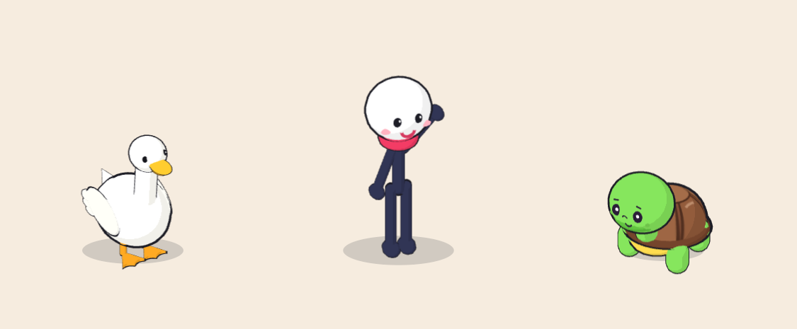

# 🐾 Mascote Desktop

Um bichinho que mora na **sua tela** e conversa com você usando o **Claude Code** por trás.
Vêm três pets em **3D de verdade**: o **Palito** (padrão), o **Pato** 🦆 e a **Tartaruga** 🐢 (troque em
⚙️ → Pet). Eles giram para a direção em que andam, e cada um conversa com uma personalidade própria.



- 💬 **Chat com o Claude Code:** clique no botão laranja para conversar. Ele lê arquivos e ajuda com
  código na pasta que você escolher, sempre pedindo permissão antes de mexer em algo. Dá para
  **colar imagens** (Ctrl+V) para ele ver.
- 🧸 **Um bichinho de verdade:** ele pisca, acena, cochila e passeia (se você deixar). Clique para dar
  carinho, use o **botão direito** para dar comida ou jogar bola, **chacoalhe** e ele fica tonto (e
  depois bravo com você), e **solte ele lá do alto** para ver o paraquedas. 🪂
- 🧊 **3D de verdade:** modelos feitos com three.js, vistos de cima na diagonal. O Pato (branco, de pescoço
  comprido) anda gingando, dança de vez em quando e plana com as asas abertas em vez de usar paraquedas;
  a Tartaruga se esconde no casco dormindo, caindo ou sendo chacoalhada; o Palito usa cachecol. Se a placa
  de vídeo não tiver WebGL, ele usa sozinho um desenho com volume parecido.
- 🧱 **Chão:** ele anda pela tela inteira ou só em cima da barra de tarefas, em todos os monitores ou
  em um só.
- 😈 **Modo bagunça (opcional):** ele rouba o seu mouse (no estilo do Desktop Goose), traz bilhetinhos
  coloridos e faz travessuras como apertar Alt+Tab ou abrir o navegador. Cada travessura liga e desliga
  em ⚙️, e dá para criar as suas.
- 💌 **Feito para a comunidade:** bilhetes, travessuras e pets próprios são só arquivos JSON (veja
  [abaixo](#bilhetes-da-comunidade) e [CRIAR_PET.md](CRIAR_PET.md)).
- 🖥️ **Aplicativo de verdade (Windows):** atalho no Menu Iniciar, minimizar para a bandeja e iniciar
  junto com o PC.

Mecânicas inspiradas nos pets de desktop clássicos, com personagens e código originais.

## Requisitos

- Node.js 18 ou superior
- Claude Code instalado e logado, para o chat funcionar:
  ```bash
  npm install -g @anthropic-ai/claude-code
  claude   # faça o login uma vez e saia
  ```
  Alternativa: defina a variável `ANTHROPIC_API_KEY`.

## Rodar

```bash
npm install
npm start
```

### Abrir como um aplicativo (Windows)

Para não precisar do terminal toda vez, crie os atalhos uma vez:

```bash
npm run atalho
```

Isso coloca **Mascote Desktop**, com ícone próprio, no Menu Iniciar e na Área de Trabalho. É só
clicar para abrir, como qualquer programa, sem janela de terminal. Para tirar os atalhos:
`npm run atalho -- --remover`. Para ele abrir sozinho junto com o PC, use ⚙️ → Iniciar com o Windows.

## Como usar

| Ação | Como |
|---|---|
| Conversar | Clique no botão laranja no canto inferior direito |
| Mudar o chat de lugar | Arraste o botão do chat ou o de brinquedos, que andam juntos (ou o topo do painel aberto). ⚙️ → Chat no canto desfaz |
| Escolher em que tela o pet fica | ⚙️ → Telas (todas, ou uma específica) |
| Escolher em que pasta ele trabalha | Clique na linha 📁 no topo do chat |
| Carinho | Clique no pet |
| Dar comida / brincar de bola | Botão pequeno de brinquedos, ao lado do chat (ou botão direito no pet) |
| Chutar a bola | Clique nela: ela vai para o lado oposto de onde você clicou. O pet chuta de volta na direção do seu mouse |
| Andar só em cima da barra de tarefas | ⚙️ → Chão |
| Mudar o pet de lugar | Arraste o pet com o mouse |
| Ligar passeio / modo bagunça | ⚙️ no chat, ou o ícone na bandeja do sistema |
| Trocar de pet / abrir a pasta de pets | ⚙️ no chat |
| Escolher os bilhetes que ele traz | ⚙️ → Pasta de bilhetes |
| Ligar travessuras (pegar o mouse, Alt+Tab, navegador) / criar novas | ⚙️ → Travessuras / Pasta de travessuras |
| Fazer o pet voltar para o canto | ⚙️ → Chamar de volta |
| Minimizar | Botão **–** no topo do chat: pet, chat e bilhetes somem e fica só o ícone na bandeja (perto do relógio). Clique nele para trazer de volta |
| Fechar | Botão **X** no topo do chat, ⚙️ → Fechar o app, a bandeja, ou **Ctrl+Alt+Shift+Q** |
| Abrir de novo | Atalho **Mascote Desktop** (se já estiver aberto, ele volta da bandeja e abre o chat) |

Quando o pet rouba o seu mouse no modo bagunça, puxe o mouse com força para longe que ele solta.

### Imagens no chat

Cole uma imagem com **Ctrl+V** no campo de mensagem (ou arraste o arquivo para o chat). Vão até 4 por
mensagem (PNG, JPG, GIF ou WEBP, até 5 MB cada), e o Claude Code vê a imagem junto com o seu texto.

### Brincar com o pet


- **Chão** (⚙️ → Chão): ele pode andar pela **tela inteira** ou **só em cima da barra de tarefas**, como
  se ela fosse o chão.
- **Derrubar:** no modo barra de tarefas, arraste o pet lá para cima e solte. Ele cai e abre um
  paraquedas. 🪂
- **Chacoalhar:** segure o pet e sacuda o mouse de um lado para o outro. Ele fica tonto (estrelinhas e
  olhos em espiral) e depois fica bravo com você. Bravo, ele recusa carinho e brincadeira por um tempo.
  Uma comidinha resolve.
- **Brinquedos** (botão pequeno ao lado do chat, ou botão direito no pet): **Comida** (ele vai até a
  comida e come) e **Bola de futebol**. Clique na bola para chutar: ela vai para o lado oposto de onde
  você clicou, e o pet corre atrás e chuta de volta na direção do seu mouse. Se você parar de jogar,
  depois de uns 15 s ele cansa. A bola segue o **Chão** escolhido: no modo barra de tarefas ela
  tem gravidade e quica em cima da barra; no modo tela inteira ela rola pela tela toda, vista de cima,
  como o pet anda. Pelo botão direito também tem **Carinho**. Se ficar muito tempo sem
  comer, ele avisa que está com fome.

## Bilhetes da comunidade

No modo bagunça o pet traz bilhetes. Ele já vem com 40 mensagens, e você pode colocar as suas:
abra **⚙️ → Pasta de bilhetes** e edite o `bilhetes.json`:

```json
{
  "substituir": false,
  "bilhetes": [
    "Só um texto",
    { "texto": "Com cor própria 💜", "cor": "#e8dcff" },
    { "imagem": "gatinho.png" },
    { "imagem": "meme.gif", "texto": "legenda se a imagem falhar", "cor": "#d4f1ff" }
  ]
}
```

- As imagens ficam na mesma pasta (png, jpg, gif ou webp, até 5 MB).
- `cor` é opcional (`#rrggbb`); sem ela, ele sorteia uma cor de post-it.
- `"substituir": true` usa **só** os seus bilhetes; com `false`, eles se juntam aos padrão.
- Vale na hora, sem reiniciar. Pets também podem ter bilhetes próprios no `pet.json`.

## Travessuras

Com o modo bagunça ligado, ative em **⚙️ → Travessuras** as que quiser. "Pegar o mouse" vem ligada;
as outras começam desligadas.
Ele faz no máximo uma a cada 3 minutos (e nenhuma nos 3 primeiros minutos depois de abrir o app). Para criar as suas, abra **⚙️ → Pasta de travessuras**
e edite o `travessuras.json`:

```json
{
  "travessuras": [
    { "id": "minimiza-tudo", "nome": "Minimizar tudo", "tipo": "teclas", "teclas": ["win", "d"], "vezes": 1 },
    { "id": "alt-tab-doido", "nome": "Alt+Tab doido", "tipo": "teclas", "teclas": ["alt", "tab"], "vezes": [3, 8] },
    { "id": "patos", "nome": "Fotos de patos", "tipo": "abrir", "links": ["https://www.google.com/search?q=patos+fofos"] }
  ]
}
```

- **teclas:** as primeiras ficam seguradas e a última é apertada `vezes` vezes (número ou
  `[mín, máx]`, até 10). Só são aceitas teclas que não apagam, enviam ou fecham nada:
  `alt, tab, shift, win, esquerda, cima, direita, baixo, d, m`. Por enquanto só no Windows.
- **abrir:** sorteia um dos links (só `http://` ou `https://`).
- **"admin": true:** a travessura aparece com cadeado e só pode ser ligada com o app rodando como
  administrador.

Além dessas, há duas que o próprio pet faz: **Seguir o mouse** (vai atrás do cursor sem pegar) e
**Pegar o mouse**, que imita o Desktop Goose. Ele morde o cursor, corre segurando e solta se você
puxar com força.

### Permissão de administrador (opcional)

Nada no mascote precisa de administrador. A diferença é que, sem a permissão, o Windows não deixa um
programa comum apertar teclas quando a janela da frente é de administrador (Gerenciador de Tarefas,
terminal admin...). Nesses casos ele pula a travessura. Para liberar, use **⚙️ → Pedir permissão ao
Windows**: o app reabre e o Windows pergunta se você permite. Depois disso, a opção "Também em janelas
de administrador" pode ser ligada.

Cuidado: como administrador, o chat (Claude Code) também roda com essa permissão. Os pedidos de
Permitir/Negar continuam aparecendo, então leia bem cada um.

**⚙️ → Iniciar com o Windows** faz o mascote abrir sozinho quando você liga o PC (não precisa de admin).

## Problemas?

O app grava um log em `%APPDATA%mascote-desktoplogsmascote.log` (Windows),
`~/Library/Application Support/mascote-desktop/logs` (macOS) ou `~/.config/mascote-desktop/logs` (Linux),
incluindo erros das páginas. Se o pet sumir da tela, ele volta sozinho para o canto em ~3 s.

Para depurar: `MASCOTE_DEBUG=perseguir npm start` (persegue o mouse sem parar) ou
`MASCOTE_DEBUG=travessura npm start` (faz as travessuras ligadas sem intervalo) ou
`MASCOTE_DEBUG=voltar npm start` (leva o pet para longe e chama de volta) ou
`MASCOTE_DEBUG=bilhete npm start` (no modo bagunça, ele vai buscar bilhetes toda hora) ou
`MASCOTE_DEBUG=dancar npm start` (o Pato dança sem parar).

## Segurança

- As páginas rodam isoladas (`contextIsolation` + `sandbox`, sem Node) e só falam com o
  processo principal por uma lista fixa de canais, com os dados validados.
- Nenhuma janela navega para fora do app, abre pop-ups ou recebe permissões do navegador.

O pet usa o Claude Code, que pode ler arquivos e rodar comandos. **Toda ação que mexe
no computador aparece no chat com os botões Permitir e Negar.** Nada roda sem você
aprovar.

## Limitações conhecidas (protótipo)

- Com monitores de escalas (DPI) diferentes, o desenho pode ficar maior num deles.
- No Linux com Wayland, o pet não consegue pegar o mouse (o resto funciona).
- No Linux, a transparência precisa de um compositor (o padrão no GNOME e KDE).
- No macOS, pegar o mouse pode pedir permissão de Acessibilidade.

## Créditos

- Ícones do chat: [Lucide](https://lucide.dev) (licença ISC, em `src/icones/LICENSE-lucide.txt`).
- Pets, ícone do app e desenhos: originais deste projeto (`src/pet3d.js`, com reserva em `src/vetor.js`).
- 3D: [three.js](https://threejs.org) (licença MIT).

## Observações

- Usa o Claude Code da sua própria conta, instalado no seu computador.
- Projeto não oficial, sem vínculo com a Anthropic. Não usa logo nem identidade
  visual do Claude/Anthropic.
- Se for distribuir para outras pessoas, leia os termos atuais sobre uso do Agent SDK:
  https://code.claude.com/docs/en/legal-and-compliance
